# Kế hoạch Triển khai Sprint 4 — Đa dạng hóa Học liệu AI: Flashcard, Mindmap & Interactive Slides

> **Dự án:** FLTS (Flipped Learning Teaching System)  
> **Thời gian dự kiến:** 23/10/2026 – 19/11/2026 (Gộp và hoàn thiện toàn bộ học liệu MVP)  
> **Tài liệu tham chiếu:** `docs/reference/C1SE32-Project Plan_FLTS_ver1.0.docx`, `docs/reference/C1SE32_UserStory_FTLS_ver1.1.docx`  
> **Phiên bản kế hoạch:** v1.0  
> **Người lập:** Nhóm phát triển Capstone FLTS  

---

## 1. Mục tiêu Cốt lõi của Sprint 4 (Sprint Goal)

Sau khi Sprint 3 đã hoàn thành xuất sắc luồng **Quiz RAG Vertical Slice** và nâng cấp giao diện theo **Coursera Design System**, mục tiêu chiến lược của Sprint 4 là hoàn thiện toàn diện hệ sinh thái **4 loại học liệu Flipped Learning cốt lõi** theo đúng đề cương đồ án:

1. **Flashcard (Thẻ ghi nhớ thông minh — PB25 / US-16 & US-29):** Tự động trích xuất các thuật ngữ, định nghĩa, định lý trọng tâm từ giáo trình; sinh viên ôn tập theo phương pháp lặp lại ngắt quãng (Spaced Repetition) với hiệu ứng lật thẻ 3D.
2. **Mindmap (Bản đồ tư duy phân cấp — PB26 / US-17 & US-29):** Tự động trích xuất cấu trúc bài học thành cây sơ đồ tư duy phân cấp trực quan; hỗ trợ thu phóng (zoom/pan), mở rộng/thu gọn nhánh (fold/unfold) và render công thức KaTeX.
3. **Interactive Slides (Bài giảng tương tác — PB27 / US-18 & US-29):** Tự động biên soạn bộ slide bài giảng tóm lược ý chính, câu hỏi thảo luận và ghi chú của giảng viên (Speaker Notes); hỗ trợ trình chiếu toàn màn hình (Fullscreen) trước giờ lên lớp.
4. **Trải nghiệm học tập tập trung cho Sinh viên (Unified Learning Hub — PB37 / US-29):** Sinh viên truy cập vào khóa học có thể lựa chọn linh hoạt hình thức học tập phù hợp (Làm Quiz, Lật Flashcard, Xem Sơ đồ tư duy, Trình chiếu Slide).

---

## 2. Thiết kế Kiến trúc Kỹ thuật Mở rộng (Technical Architecture)

### 2.1. Thiết kế Cơ sở Dữ liệu (MySQL Schema Migration)
Khai thác kiến trúc đa hình (Polymorphic JSON payload) đã được xây dựng sẵn từ Sprint 3 trong bảng `learning_objects` và `learning_object_versions`:

1. **Migration mở rộng enum `learning_objects.type`:**
   ```sql
   ALTER TABLE learning_objects MODIFY COLUMN type ENUM('quiz', 'flashcard', 'mindmap', 'slide') NOT NULL;
   ```
2. **Cấu trúc `content_payload` linh hoạt trong `learning_object_versions`:**
   - **Flashcard:**
     ```json
     {
       "cards": [
         {
           "id": 1,
           "front": "Định nghĩa Ma trận khả nghịch (Invertible Matrix)",
           "back": "Một ma trận vuông A cấp n được gọi là khả nghịch nếu tồn tại ma trận B sao cho $AB = BA = I_n$.",
           "hint": "Liên quan đến tích của hai ma trận bằng ma trận đơn vị",
           "citations": [{ "vector_id": "chunk_12", "document_name": "Giao_trinh_Dai_so.pdf", "page": 42 }]
         }
       ]
     }
     ```
   - **Mindmap:**
     ```json
     {
       "root": {
         "id": "root",
         "label": "Không gian Vector",
         "children": [
           {
             "id": "node_1",
             "label": "Định nghĩa & 8 Tiên đề",
             "children": [
               { "id": "node_1_1", "label": "Phép cộng vector (4 tiên đề)", "children": [] },
               { "id": "node_1_2", "label": "Phép nhân vô hướng (4 tiên đề)", "children": [] }
             ]
           },
           {
             "id": "node_2",
             "label": "Không gian con (Subspace)",
             "children": []
           }
         ]
       },
       "markdown": "# Không gian Vector\n## Định nghĩa\n- Phép cộng\n- Phép nhân\n## Không gian con"
     }
     ```
   - **Interactive Slide:**
     ```json
     {
       "slides": [
         {
           "slide_number": 1,
           "title": "Tổng quan về Không gian Vector",
           "layout": "bullet_points",
           "bullet_points": [
             "Khái niệm tập hợp vector trên trường số thực $\\mathbb{R}$",
             "Tính đóng đối với phép cộng và phép nhân vô hướng",
             "Ứng dụng trong khoa học dữ liệu và đồ họa máy tính"
           ],
           "speaker_notes": "Nhấn mạnh với sinh viên tầm quan trọng của tính đóng trước khi kiểm tra 8 tiên đề.",
           "citations": [{ "document_name": "Giao_trinh_Dai_so.pdf", "page": 15 }]
         }
       ]
     }
     ```

### 2.2. AI Microservice Backend (Python FastAPI)
Thêm 3 endpoints sinh học liệu có xác thực Pydantic schema nghiêm ngặt:
- `POST /internal/v1/learning-objects/generate-flashcards`: Nhận context giáo trình, sinh danh sách thẻ 2 mặt kèm gợi ý và trích dẫn.
- `POST /internal/v1/learning-objects/generate-mindmap`: Nhận context giáo trình, sinh cây phân cấp cây đa cấp (Hierarchy Tree) kèm markdown outline.
- `POST /internal/v1/learning-objects/generate-slides`: Nhận context giáo trình, chia nội dung thành 5–10 slide bài giảng kèm `speaker_notes`.
- Toàn bộ prompt được tích hợp quy tắc **Formula Auditing & KaTeX Auto-correction** để bảo đảm công thức toán luôn hiển thị hoàn hảo.

### 2.3. Frontend Client (Vue 3 + Coursera Design System)
Xây dựng các components chuyên biệt:
- `FlashcardPlayer.vue`: Thẻ lật 3D tương tác (CSS 3D Transform: `rotateY(180deg)`), hỗ trợ phím cách (Space) để lật, phím mũi tên (Arrow Left/Right) để chuyển thẻ, nút đánh dấu "Đã hiểu / Cần xem lại".
- `MindmapViewer.vue`: Trình diễn bản đồ tư duy mượt mà bằng SVG tương tác hoặc `markmap` với khả năng zoom, kéo chuột (pan), gấp/mở cành cây, hiển thị công thức KaTeX trong từng nhánh.
- `SlidePlayer.vue`: Trình phát slide hiện đại, chuyển slide mượt, hỗ trợ xem ghi chú giảng viên (Speaker Notes), chế độ trình chiếu toàn màn hình (Fullscreen API).
- Cập nhật trang tạo học liệu [**`LearningObjectsView.vue`**](file:///d:/CMU/Capstone1/FLTS/frontend/src/views/LearningObjectsView.vue): Cho phép Giảng viên chọn tab: **[Quiz] | [Flashcard] | [Mindmap] | [Slides]**.

---

## 3. Phân rã Công việc theo Giai đoạn (Work Breakdown Structure - WBS)

```mermaid
flowchart TD
    A["Sprint 4: Học liệu Đa phương thức"] --> B["Phase 1: Database & AI Backend"]
    A --> C["Phase 2: Laravel Gateway & Jobs"]
    A --> D["Phase 3: Giảng viên Authoring UI"]
    A --> E["Phase 4: Sinh viên Learning Hub"]
    A --> F["Phase 5: Kiểm thử & Đóng gói Demo"]

    B --> B1["Migration enum type"]
    B --> B2["FastAPI Flashcard Generator"]
    B --> B3["FastAPI Mindmap Generator"]
    B --> B4["FastAPI Slide Generator"]

    C --> C1["Queue Jobs: ProcessFlashcard, ProcessMindmap, ProcessSlide"]
    C --> C2["Background Task Center mapping"]
    C --> C3["API Publish, Version snapshot, CRUD"]

    D --> D1["LearningObjectsView: Bộ chọn 4 loại học liệu"]
    D --> D2["FlashcardEditorView.vue"]
    D --> D3["MindmapEditorView.vue"]
    D --> D4["SlideEditorView.vue"]

    E --> E1["StudentCourseView: 4 tab học tập Coursera"]
    E --> E2["FlashcardPlayer: Lật thẻ 3D + Phím tắt"]
    E --> E3["MindmapViewer: Thu phóng + Gấp nhánh"]
    E --> E4["SlidePlayer: Trình chiếu Fullscreen + Notes"]

    F --> F1["Pytest AI suite (>30 tests)"]
    F --> F2["PHPUnit feature suite (>45 tests)"]
    F --> F3["Docker build & Kịch bản Demo Hội đồng"]
```



---

## 4. Bảng Phân bổ User Story & Chi tiết Kỹ thuật

| Mã US | Mã PB | Tên hạng mục | Vai trò | Mô tả tóm tắt kỹ thuật | Dự toán |
|---|---|---|---|---|---:|
| **US-16** | **PB25** | **Flashcard Generation** | Giảng viên | FastAPI trích xuất đoạn văn, sinh 5–15 thẻ thuật ngữ/khái niệm 2 mặt có trích dẫn nguồn. Lưu bản nháp `draft`. | 18h |
| **US-17** | **PB26** | **Mindmap Generation** | Giảng viên | AI phân tích cấu trúc bài học, sinh cây phân cấp JSON (gốc, nhánh lớn, nhánh con) và Markdown outline. | 20h |
| **US-18** | **PB27** | **Interactive Slide Generation** | Giảng viên | AI tóm lược giáo trình thành 5–10 slide bài giảng, mỗi slide gồm tiêu đề, 3–5 bullet points và speaker notes. | 22h |
| **US-19** | **PB28** | **Output Schema Validation** | Hệ thống | Pydantic model kiểm tra chặt chẽ cấu trúc JSON của từng loại học liệu trước khi lưu vào CSDL. | 8h |
| **US-21** | **PB30** | **Preview & Review** | Giảng viên | Xem trước trực quan Flashcard, Mindmap, Slide trước khi xuất bản cho sinh viên. | 12h |
| **US-22** | **PB31** | **Edit & Versioning** | Giảng viên | Cho phép sửa trực tiếp từng thẻ flashcard, từng nút trên sơ đồ, từng slide bài giảng. Lưu thành Version mới. | 12h |
| **US-24** | **PB33** | **Approve & Publish** | Giảng viên | Phê duyệt xuất bản để sinh viên có thể truy cập; khóa chỉnh sửa bản đã công bố để đảm bảo toàn vẹn. | 10h |
| **US-29** | **PB37** | **Student Multi-mode Interaction** | Sinh viên | Giao diện học tập cho sinh viên: Lật Flashcard 3D, thu phóng Mindmap, trình chiếu Slide bài giảng. | 20h |
| **US-26** | **PB39** | **Basic Usage Analytics** | Giảng viên | Thống kê số lượng học liệu đã tạo, số sinh viên đã học theo từng loại học liệu trong khóa. | 10h |

---

## 5. Lộ trình Thực hiện theo Tuần (Sprint Timeline)

### 📅 Tuần 1 (23/10 – 29/10/2026): Nền tảng Backend & Flashcard Vertical Slice
- [ ] Chạy migration mở rộng enum `type` trong bảng `learning_objects`.
- [ ] Xây dựng Pydantic Schema và Endpoint sinh Flashcard tại `ai-service/main.py`.
- [ ] Xây dựng Job Laravel `GenerateFlashcardLearningObject` tích hợp Queue Worker và Background Task Center.
- [ ] Xây dựng component `FlashcardEditorView.vue` và `FlashcardPlayer.vue` (hiệu ứng lật 3D, hỗ trợ phím Space/Mũi tên).
- [ ] Viết kiểm thử tự động: Pytest cho Flashcard generator, PHPUnit cho Flashcard API.

### 📅 Tuần 2 (30/10 – 05/11/2026): Mindmap / Sơ đồ tư duy Phân cấp
- [ ] Xây dựng Prompt phân tích cây tri thức và Endpoint sinh Mindmap JSON tại `ai-service/main.py`.
- [ ] Xây dựng Job Laravel `GenerateMindmapLearningObject`.
- [ ] Xây dựng component `MindmapViewer.vue` hiển thị cây sơ đồ tư duy tương tác: Thu phóng, kéo thả, gấp/mở nhánh, render công thức toán KaTeX.
- [ ] Tích hợp tính năng chỉnh sửa nhánh sơ đồ tư duy cho Giảng viên.

### 📅 Tuần 3 (06/11 – 12/11/2026): Interactive Slides (Bài giảng tương tác)
- [ ] Xây dựng Endpoint sinh bộ Slide bài giảng kèm Speaker Notes tại `ai-service/main.py`.
- [ ] Xây dựng Job Laravel `GenerateSlideLearningObject`.
- [ ] Xây dựng component `SlidePlayer.vue`: Trình chiếu slide chuẩn Coursera, thanh tiến trình slide, chế độ toàn màn hình Fullscreen, hộp ghi chú giảng viên.
- [ ] Hoàn thiện giao diện Sinh viên [**`StudentCourseView.vue`**](file:///d:/CMU/Capstone1/FLTS/frontend/src/views/StudentCourseView.vue) gồm 4 tab học tập: **[Quiz] | [Flashcard] | [Sơ đồ tư duy] | [Slide bài giảng]**.

### 📅 Tuần 4 (13/11 – 19/11/2026): Kiểm thử Tổng thể, Tối ưu & Chuẩn bị Báo cáo Capstone
- [ ] Chạy toàn bộ regression test suites (PHPUnit > 45 tests, Pytest > 30 tests).
- [ ] Kiểm tra tính toàn vẹn của ChromaDB: Giữ vững và mở rộng tập vector giáo trình.
- [ ] Đóng gói kịch bản Demo hoàn chỉnh cho Hội đồng chấm đồ án: Nạp tài liệu nhanh → Tự động sinh Quiz, Flashcard, Mindmap, Slides → Sinh viên trải nghiệm học tập đa phương thức.
- [ ] Cập nhật tài liệu kỹ thuật và hoàn thiện báo cáo luận văn tốt nghiệp Capstone.

---

## 6. Tiêu chí Hoàn thành (Definition of Done - DoD)

1. **Tính tương thích ngược 100%:** Toàn bộ tính năng Quiz, xác thực, quản lý khóa học, sinh viên và 551 vector ChromaDB hiện tại hoạt động bình thường, không xảy ra xung đột.
2. **Schema & Validation:** Mọi học liệu AI sinh ra đều phải tuân thủ JSON Schema, có trích dẫn tài liệu nguồn (Grounded Citations) và không chứa lỗi định dạng công thức toán.
3. **Trải nghiệm Coursera đồng nhất:** Tất cả 3 loại học liệu mới đều sử dụng bảng màu Coursera Royal Blue (`#0056D2`), bo góc chuẩn, typography rõ ràng và hỗ trợ responsive trên mọi kích thước màn hình.
4. **Kiểm thử tự động:** Toàn bộ các bài test mới phải đạt tỷ lệ 100% Passed trên cả Laravel và FastAPI.
